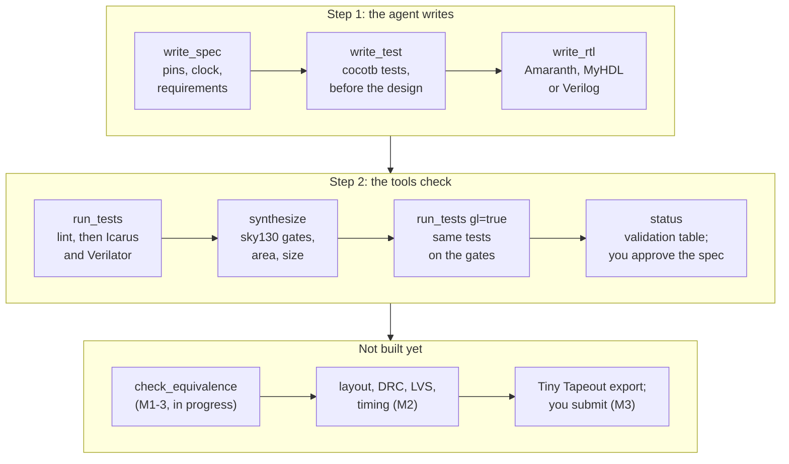

# Siliconsmith

**Let your AI coding agent design a small chip, with open-source tools only.**

[](https://github.com/RFingAdam/siliconsmith/actions/workflows/ci.yml)
[](https://github.com/RFingAdam/siliconsmith/actions/workflows/image.yml)
[](LICENSE)
[](pyproject.toml)

[See it work](#see-it-work) · [How it works](#how-it-works) · [Status](#status) · [Quick start](#quick-start) · [Tools](#tools) · [Honest limits](#honest-limits) · [Docs](#documentation)

Describe a small chip in one sentence. Your agent writes a spec, tests and the design, runs the
tests on two simulators, maps the design to sky130 standard cells (a gate netlist) and runs the
same tests on those gates. You read the spec and approve it.

**Status (0.1.0.dev0, early):** today a design goes from a one-line idea to a tested sky130 gate
netlist. It cannot make a chip yet: layout (M2) and the Tiny Tapeout export (M3) are not built, so
there is nothing to submit. When they land, you will submit and pay on the Tiny Tapeout site
yourself; Siliconsmith never does. [Full status](#status).

## What is this?

Siliconsmith is an **MCP server**: a small program that an AI coding agent (Claude Code, Cursor,
Codex) starts on your machine and talks to, which gives the agent new tools. Here, those tools
design digital chips. The agent writes the design (the **RTL**, a description of the chip's logic)
in Amaranth, MyHDL or Verilog, tests it with **cocotb** (testbenches written in Python), and
checks it on the Icarus and Verilator simulators. Then **synthesis** maps it onto **standard
cells** (ready-made gates and flip-flops) from the open SkyWater 130 nm process (**sky130**).

The target is [Tiny Tapeout](https://tinytapeout.com/), an educational project that makes it
cheaper and easier to get a small design made on a real chip. Many projects share one chip, and
each project gets a **tile**: a small slice of the chip (a 1x1 tile holds roughly a thousand logic
gates) with 8 inputs (`ui_in`), 8 outputs (`uo_out`) and 8 bidirectional pins (`uio`), plus a
clock and a reset.

Every chip tool runs inside one pinned Docker image, so you install only Python and Docker.

New to digital design? Start with the [beginner guide](docs/beginner-guide.md). It is written for
engineers who know RF and analog hardware and are new to digital design. Unfamiliar word (RTL,
lint, netlist, DRC, LVS)? The [glossary](docs/glossary.md) explains 42 terms in plain English.

## See it work

This is a recorded headless Claude Code session from 2026-11-12. It was made before synthesis
landed, so it stops at simulation. It starts in an empty folder with exactly one prompt and only
Siliconsmith's tools: no shell, no file editor, no web.

> 8-bit counter on uo_out, count enable on ui_in[0]

The agent wrote a spec, tests and a Verilog design, then ran the tests. The first run failed:

```text
run_tests failed on icarus: 1 passed, 2 failed, 0 skipped (3 tests).
First failure: test_count_and_hold (test/test.py:36)
  assertion: assert v == 5, f"expected 5 got {v}"
  expected: 5
  actual:   4
  message: AssertionError: expected 5 got 4
Other failing tests: test_wrap
Requirements covered by passing tests: R1
Not covered yet: R2, R3, R4
```

It found the cause, fixed it, and ran the tests again:

```text
run_tests ok on icarus: 3 passed, 0 failed, 0 skipped (3 tests).
Passed: test_reset, test_count_and_hold, test_wrap
Requirements covered by passing tests: R1, R2, R3, R4
```

*Excerpt from [docs/demos/verilog-20261112-1.md](docs/demos/verilog-20261112-1.md), lines
220-234 and 328-336. The same failure and fix show up on Verilator.*

Notice what the fix was. The bug was in the agent's **own test**: it read `uo_out` on the clock
edge, before the register had updated. The agent moved the read to 1 ns after each edge and left
the design alone. An agent can always write a test that agrees with its own mistake. That is why
every demo is also checked with a frozen reference test (`tests/reference/test_counter_reference.py`)
that the agent never saw. It passed on both simulators for all three design languages:

| Design language | Turns | `run_tests` calls | Cost (USD) | Minutes | Agent's tests (Icarus, Verilator) | Reference test (Icarus, Verilator) |
| --- | --- | --- | --- | --- | --- | --- |
| Verilog | 14 | 4 | 0.14 | 1.0 | pass, pass | pass, pass |
| MyHDL | 12 | 2 | 0.12 | 0.8 | pass, pass | pass, pass |
| Amaranth | 12 | 2 | 0.12 | 0.8 | pass, pass | pass, pass |

Recorded with claude-sonnet-5-5 and Claude Code 2.1.322 at commit `ec7ed2d` (branch
`m0-6-skills-demo`, squash-merged as `d52be04` in
[#60](https://github.com/RFingAdam/siliconsmith/pull/60)). The MyHDL and Amaranth rows are marked
`+dirty`: the recorder saw uncommitted or untracked files in the checkout
(`git status --porcelain`) and does not record which. It is one counter, one model and one day.
Every attempt is listed, and a transcript is never edited. [Read the transcripts and how they are
verified.](docs/demos/README.md)

## How it works



When a check fails, the agent gets the expected and actual values (and a waveform when it asks
for one) and goes back to step 1. The parts:

- **An MCP server** that runs on your machine and talks to the agent over stdin and stdout, so
  nothing listens on the network. Every tool answers with a short plain-English summary,
  structured details (lint findings with file and line, expected and actual values) and hints
  for the next step. A bad argument comes back as a tool error that says what to do.
- **Skills**: five playbooks (`chip-design-loop`, `tt-rules`, `amaranth-style`, `myhdl-style`,
  `cocotb2-tests`) and a 42-term plain-English glossary. The agent reads them through the
  `explain` tool, so the guidance travels with the server.
- **A pinned toolchain image** with Icarus Verilog, Verilator, Yosys, cocotb, Amaranth, MyHDL and
  the sky130 cell library files. Same versions on every machine and in CI. See
  [Toolchain image](#toolchain-image).
- **A hardened container runner.** Code the agent writes (Amaranth or MyHDL designs, cocotb tests)
  never runs on your machine directly, and the server never imports it. Each call gets a fresh
  container with no network, a read-only root filesystem, all Linux capabilities dropped, and
  limits on memory (4 GB), CPUs (2) and processes (512). Your design and tests are mounted
  read-only; only the project's `build/` folder is writable.
- **A validation ledger.** Each check records what it ran against. `status` turns that into a
  12-row table (pass, fail, stale, not run, not available) and writes it to the project's
  `docs/verification.md`. When a file changes, the checks that depend on it turn **stale**.
- **An owner step.** Only you approve the spec, with `siliconsmith approve` in a terminal. No
  tool can do it.

The design is always a core module on the Tiny Tapeout pins (`clk`, `rst_n`, `ena`, `ui_in[7:0]`,
`uio_in[7:0]` in; `uo_out[7:0]`, `uio_out[7:0]`, `uio_oe[7:0]` out). Siliconsmith generates the
`tt_um_<name>` wrapper around it. Pick one **front-end** per project. Here that means the language
the design is written in, not an RF front end:

| Front-end | You (or the agent) write | Notes |
| --- | --- | --- |
| Amaranth 0.5 | `hdl/<name>.py` | Converted to Verilog inside the container. Amaranth cannot infer a latch: an unassigned signal keeps its default. |
| MyHDL 0.11 | `hdl/<name>.py` | Converted inside the container. Lint and synthesis findings point back to your `hdl/` function and line. |
| Verilog | `src/<name>.v` | Used as written. Yosys reads it with `read_verilog -sv`. |

## Status

Version `0.1.0.dev0`: early, with no releases yet.

| Track | Milestone | What it brings | State |
| --- | --- | --- | --- |
| Digital | M0: simulation | Projects, spec, tests, design, Verilog emit and lint, cocotb on Icarus and Verilator, waveforms, validation ledger, `explain`, owner approval, three recorded demos | **Done** |
| Digital | M1: synthesis (M1-0 to M1-2) | sky130 files in the image and `tt.lock` (M1-0), `synthesize` (M1-1), gate-level simulation (M1-2) | **Done** |
| Digital | M1: equivalence (M1-3) | [`check_equivalence`](https://github.com/RFingAdam/siliconsmith/issues/44): prove the gate netlist matches the RTL as Yosys reads it | **In progress** |
| Digital | [M2: layout](https://github.com/RFingAdam/siliconsmith/issues?q=is%3Aissue%20label%3Amilestone%3AM2) | LibreLane layout on sky130 at Tiny Tapeout tile size: GDS, DRC, LVS, timing, reports, layout pictures | **Next** |
| Digital | [M3: Tiny Tapeout ready](https://github.com/RFingAdam/siliconsmith/issues?q=is%3Aissue%20label%3Amilestone%3AM3) | Export a submission-ready repo, run Tiny Tapeout's checks, bring-up and shuttle guide, Claude Code plugin | Later |
| Digital | [M4: examples](https://github.com/RFingAdam/siliconsmith/issues?q=is%3Aissue%20label%3Amilestone%3AM4) | UART, SPI, PWM and NCO/DDS, a tiny CPU, an agent benchmark, a weak-test (mutation) check | Later |
| Digital | [M5: optional](https://github.com/RFingAdam/siliconsmith/issues?q=is%3Aissue%20label%3Amilestone%3AM5) | GF180 and IHP processes, streamable HTTP transport, arm64 image | Later |
| Analog/RF | [A0 to A4](https://github.com/RFingAdam/siliconsmith/issues?q=is%3Aissue%20label%3Atrack%3Aanalog-rf) | Xschem and ngspice first, then layout and LVS, then an oscillator, a VCO and an LNA, openEMS for passives, Tiny Tapeout analog export | Later |
| Acoustic | [S0 to S2](https://github.com/RFingAdam/siliconsmith/issues?q=is%3Aissue%20label%3Atrack%3Aacoustic) | SAW/BAW resonator and filter models (BVD, Mason), FEM experiments. **Simulation only.** | Later, research |

None of the analog or acoustic tools are in the image yet. There are no dates. The milestone
details and acceptance criteria are in [PLAN.md](PLAN.md) and [ISSUES.md](ISSUES.md), and the
[GitHub issues](https://github.com/RFingAdam/siliconsmith/issues) track what has landed.

## Quick start

You need:

- Linux on x86-64, the only platform CI and the demos have used. Native Windows does not work (the
  server uses POSIX-only file calls); macOS, WSL2 and arm64 are untested, and the image is
  amd64-only until M5-3.
- Docker that your own user can run without `sudo` (check with `docker run --rm hello-world`).
- Python 3.11 or newer, and [uv](https://docs.astral.sh/uv/) (or pip).
- An MCP-capable agent: Claude Code, Cursor or Codex. The recorded demos use Claude Code; the
  Cursor and Codex snippets below are checked by tests, but no recorded session uses them yet.

### 1. Install

Siliconsmith is not on PyPI yet. Install it from GitHub:

```sh
uv tool install git+https://github.com/RFingAdam/siliconsmith
```

This puts `siliconsmith` and `siliconsmith-mcp` on your `PATH` (uv usually uses `~/.local/bin`).
From a clone, `uv tool install .` does the same. With plain pip, run `pip install -e .` inside a
virtual environment, and either activate it before you start the agent or put the full path to
`siliconsmith-mcp` in the `command` field below.

### 2. Pull the toolchain image

```sh
docker pull ghcr.io/rfingadam/siliconsmith-toolchain:ctx-394870a8f4ff
```

It is about 258 MB to download. The server never pulls the image by itself. If the image is
missing, each tool that needs it stops and prints the exact `docker pull` command for the image it
expects.

### 3. Connect your agent

Make an empty folder for your chip projects. The steps below point your agent at it:

```sh
mkdir my-chips && cd my-chips
```

<details open>
<summary><b>Claude Code</b></summary>

Claude Code sets `CLAUDE_PROJECT_DIR` to your project folder (here `my-chips`) when it starts the
server, so that folder becomes the root. Put this in a `.mcp.json` file in `my-chips`:

<!-- snippet: claude-code-mcp-json -->
```json
{
  "mcpServers": {
    "siliconsmith": {
      "command": "siliconsmith-mcp",
      "args": []
    }
  }
}
```

Or add the same thing with one command:

<!-- snippet: claude-code-add -->
```sh
claude mcp add --scope project siliconsmith -- siliconsmith-mcp
```

Then run `claude` in `my-chips`. It asks you to approve the project-scoped server the first time.
Run `/mcp` to check that `siliconsmith` is connected.

</details>

<details>
<summary><b>Cursor</b></summary>

Create `.cursor/mcp.json` in `my-chips` and open that folder in Cursor. Cursor replaces
`${workspaceFolder}` with the folder that holds `.cursor/mcp.json`:

<!-- snippet: cursor-mcp-json -->
```json
{
  "mcpServers": {
    "siliconsmith": {
      "command": "siliconsmith-mcp",
      "args": ["--root", "${workspaceFolder}"]
    }
  }
}
```

</details>

<details>
<summary><b>Codex</b></summary>

Add this to `~/.codex/config.toml`, and change the path to your `my-chips` folder. Codex's default
per-call time limit is shorter than `synthesize`'s 15-minute limit and the 25-minute worst case
for a gate-level run, so the snippet raises `tool_timeout_sec`. It also gives the server 30
seconds to start:

<!-- snippet: codex-config-toml -->
```toml
[mcp_servers.siliconsmith]
command = "siliconsmith-mcp"
args = ["--root", "/path/to/your/chip-projects"]
startup_timeout_sec = 30
tool_timeout_sec = 1800
```

</details>

These snippets are tested: `tests/test_readme_snippets.py` launches the Claude Code and Cursor
configurations over stdio, checks the tool list, and parses the Codex one.

**Where your projects go.** The server keeps all projects in one **root** folder, one subfolder
per project. It takes the root from `--root`, then the `SILICONSMITH_ROOT` environment variable,
then `CLAUDE_PROJECT_DIR`, then the folder it was started in. It refuses `/` and your home folder
unless you pass them with `--root` on purpose. `--default-frontend amaranth|myhdl|verilog` lets
`create_project` skip the `frontend` argument.

### 4. Try it

Check the setup first: ask the agent to "call Siliconsmith's `toolchain_info`". It reports Docker,
the image and every tool's version.

Then ask for a chip:

> Use Siliconsmith to design an 8-bit counter on uo_out with a count enable on ui_in[0]. Use Verilog.

The agent should start with `explain('chip-design-loop')`, write the spec and tests before the
design, and finish with `status`. Then it is your turn: read the project's `spec.yaml`, and if it
says what you want, run `siliconsmith approve <project folder>`.

## Tools

The server offers 13 tools today.

| Tool | What it does |
| --- | --- |
| `toolchain_info` | Checks that Docker and the toolchain image work, and reports every tool's version and the sky130 files. Call it first when anything fails with a toolchain error. |
| `create_project` | Creates a project shaped like a Tiny Tapeout Verilog project: a working starter design, the `tt_um_<name>` wrapper, `spec.yaml`, `info.yaml`, a cocotb test and its Makefile. |
| `list_files` | Lists a project's files and sizes (build output hidden by default). |
| `read_file` | Reads a text file in a project, whole or by line range. |
| `write_spec` | Validates `spec.yaml` (clock, tiles, reset, pins, requirements R1, R2, ..., open questions) and saves it only if it is valid. Copies the clock and tile size into Tiny Tapeout's config files. |
| `write_test` | Writes a whole cocotb 2.x test file and syntax-checks it. Each test says which requirements it covers (`Covers: R1`). |
| `write_rtl` | Writes a whole design file. A Python design is syntax-checked here but only ever run in the container. |
| `emit_verilog` | Turns the design into Verilog, checks its ports against the Tiny Tapeout pins, regenerates the wrapper, and lints with Verilator `-Wall` and Yosys (latches, multiple drivers and logic loops are errors). |
| `run_tests` | Emits, lints, then runs the cocotb tests on Icarus or Verilator. A failure gives the test, file and line, the assertion, and expected vs actual. `waves=true` keeps a wave file. `gl=true` (Icarus) runs the same tests on the sky130 gates and, when one fails, names the first clock cycle where the pins differ from the RTL run. |
| `inspect_waves` | Shows how chosen signals changed in a kept wave file, as a short table (RTL or gate-level). |
| `synthesize` | Builds the design from sky130 standard cells with Yosys, following the LibreLane 3.0.14 recipe that Tiny Tapeout uses. Reports cells (flip-flops vs logic), area, top cell types and an estimated tile utilization. Catches loops, double drivers, undriven outputs, cells Tiny Tapeout forbids, and designs far too big for the tile. |
| `status` | Shows the validation table and writes it to `docs/verification.md`. It only reads the ledger; it never runs a simulation. |
| `explain` | Answers in plain English from the skills and the glossary. Try `explain('chip-design-loop')`, `explain('latch')` or `explain('list')`. |

Coming next: `check_equivalence` (M1-3, in progress). It will prove that the gate netlist does what
the RTL does as Yosys reads it, and refuse the common constructs that a simulator and synthesis
read differently. Gate-level simulation stays the check against simulation behaviour.

**Command line.** Two commands come with the install:

| Command | What it does |
| --- | --- |
| `siliconsmith-mcp [--root DIR] [--default-frontend FE]` | Runs the MCP server over stdio. `siliconsmith server` is the same thing. |
| `siliconsmith status <project folder>` | Prints the validation table and writes `docs/verification.md`. |
| `siliconsmith approve <project folder>` | You approve `spec.yaml`. It shows the requirements, asks you to type `approve`, and records your git `user.name` and the spec's hash in the ledger. It needs a terminal. |
| `siliconsmith --version` | Prints the version. |

Environment variables: `SILICONSMITH_IMAGE` (use a different toolchain image),
`SILICONSMITH_ROOT` and `CLAUDE_PROJECT_DIR` (the project root, see above).

## Honest limits

Siliconsmith is built to tell you what has been checked and what has not.

- **Siliconsmith never reports a check it did not run.** `status` shows only what the ledger
  recorded for the current files. A test run with a filter never counts as a full run, and a
  changed file turns its checks stale.
- **A green table means the agent's own tests pass.** It does not mean the tests are strong. The
  demos use a held-out reference test for exactly that reason, and a weak-test (mutation) check
  is planned for M4.
- **Passing simulation is not working silicon.** Utilization is an estimate until layout (M2),
  and nothing checks timing before then.
- **Approval is an honest-use convention, not a security boundary.** It stops an honest agent from
  approving its own work, and the ledger shows who approved which version of the spec. An agent
  with its own shell could still run the command.
- **The checks catch honest mistakes, not a hostile design.** The container protects your machine
  from the code it runs. It does not stop a design written to cheat from faking its own test
  result. See [SECURITY.md](SECURITY.md).
- **Nothing is ever ordered, submitted or paid for automatically.** When M3 lands, Siliconsmith
  will export a submission-ready repository. You submit it and pay for it on the Tiny Tapeout
  website yourself.
- **No 2.4 GHz radio.** A working 2.4 GHz Bluetooth radio is not realistic on a Tiny Tapeout
  analog tile (a judgement from the specs, not a measurement). The analog track aims at small
  blocks: an oscillator through layout, and a VCO and an LNA at least in simulation.
- **No SAW/BAW fab.** The acoustic track is design and simulation only. There is no open fab path
  for these devices in this project.
- **Open-source tools only.** No commercial EDA, not even as an option.

## Toolchain image

Every simulator and chip tool runs inside one Docker image. It has no network access when
Siliconsmith runs it.

    ghcr.io/rfingadam/siliconsmith-toolchain:ctx-394870a8f4ff

Size (linux/amd64 only): about 816 MB unpacked, and about 258 MB to download. An arm64 image is
planned (M5-3).

<details>
<summary>How the size is measured</summary>

The unpacked figure is the sum of the layer sizes that `docker history --human=false` lists.
`docker images` can show more (about 1.07 GB on a Docker that uses the containerd image store),
because it counts disk use.

</details>

What is inside: Icarus Verilog 12, Verilator 5.046, Yosys 0.62 (the YoWASP build, the same Yosys
version as LibreLane 3.0.14), cocotb 2.1.0, pytest, Amaranth 0.5.10, MyHDL 0.11.52, a waveform
reader (pywellen), and ten sky130 files, about 17 MB: the typical-corner cell library, the
`sky130_fd_sc_hd` cell models and LibreLane's synthesis maps. They come from the open_pdks release
that Tiny Tapeout uses (pinned in [tt.lock](tt.lock)) and are checked against a pinned sha256 at
build time. `toolchain_info` reports them as `pdk`. The full PDK and the layout tools are not in
the image yet; they come with M2.

The tag is a hash of the `docker/` folder, so it changes whenever anything in `docker/` changes.
Each Siliconsmith version asks for exactly the image built from its own `docker/` folder (a test
keeps the two in sync), so after you update Siliconsmith you may need to pull a new tag. To use a
different image, set `SILICONSMITH_IMAGE` for the server, and pass the same name to
`siliconsmith status --image`, because the image is part of what makes a result stale.

To build it yourself instead:
`docker build -t ghcr.io/rfingadam/siliconsmith-toolchain:ctx-394870a8f4ff docker/`

## Documentation

| Document | What it is for |
| --- | --- |
| [docs/beginner-guide.md](docs/beginner-guide.md) | Start here if you are new to digital design: the loop, what each check proves, approving a spec. |
| [docs/glossary.md](docs/glossary.md) | 42 terms (RTL, latch, netlist, utilization, DRC, ...) in plain English, with RF comparisons. |
| [docs/demos/README.md](docs/demos/README.md) | The recorded agent sessions, how they are isolated and verified, and every attempt. |
| [docs/README.md](docs/README.md) | Index of all the documentation, with a suggested reading order. |
| [PLAN.md](PLAN.md) | Architecture, threat model, validation sequence, and every milestone with its acceptance criteria. |
| [ISSUES.md](ISSUES.md) | Every issue with its acceptance boxes, ticked as they are met. |
| [CONTRIBUTING.md](CONTRIBUTING.md) | Dev setup, the checks CI runs, license rules and the CLA. |
| [SECURITY.md](SECURITY.md) | How to report a vulnerability privately, and what the sandbox does and does not cover. |
| [THIRD_PARTY_LICENSES.md](THIRD_PARTY_LICENSES.md) | Every open-source tool used or planned, with its verified license. |

## Contributing

Issues and pull requests are welcome. Read [CONTRIBUTING.md](CONTRIBUTING.md) first: one issue
per pull request, CI green before merge, and outside contributors agree to the [CLA](CLA.md).
If you are an AI agent, or you are implementing a milestone, also read [CLAUDE.md](CLAUDE.md) and
[PLAN.md](PLAN.md).

## License

Siliconsmith's code is licensed under [AGPL-3.0-or-later](LICENSE). Your chip design stays yours:
what you and your agent write belongs to you, and the templates, the skills and every file
Siliconsmith generates in your project (starter files, the wrapper, emitted Verilog, reports) are
Apache-2.0. The extra permission that grants this is in [OUTPUT-EXCEPTION.md](OUTPUT-EXCEPTION.md).
Versions up to commit `f752b50` were published under Apache-2.0, and those copies stay under
Apache-2.0. AGPL-3.0-or-later applies from the relicense commit on. A commercial license is
available from the maintainer for uses the AGPL does not fit; open an issue to ask. See
[NOTICE](NOTICE) for attributions.

The chip tools have their own licenses, some of them GPL or LGPL. GPL tools (such as Icarus
Verilog) only ever run as separate processes; Siliconsmith never imports or links them. That
keeps the sandbox model and the option of a commercial license. Amaranth,
MyHDL (LGPL-2.1) and cocotb are used as unmodified Python libraries inside the toolchain
container. No tool's source or binaries are in this repository. `synthesize`
follows LibreLane's Apache-2.0 synthesis recipe, credited in [NOTICE](NOTICE).
[THIRD_PARTY_LICENSES.md](THIRD_PARTY_LICENSES.md) lists each tool, and the toolchain image
carries their license texts.

## Acknowledgements

Siliconsmith stands on the work of these open-source projects:
[Tiny Tapeout](https://tinytapeout.com/);
the [SkyWater sky130 open PDK](https://github.com/google/skywater-pdk) from SkyWater and Google;
[open_pdks](https://github.com/fossi-foundation/open-pdks) and
[ciel](https://github.com/fossi-foundation/ciel);
[Yosys](https://github.com/YosysHQ/yosys) and its [YoWASP](https://github.com/YoWASP/yosys) build;
[Icarus Verilog](https://github.com/steveicarus/iverilog);
[Verilator](https://github.com/verilator/verilator);
[cocotb](https://github.com/cocotb/cocotb);
[Amaranth](https://github.com/amaranth-lang/amaranth);
[MyHDL](https://github.com/myhdl/myhdl);
[LibreLane](https://github.com/librelane/librelane), whose synthesis recipe `synthesize` follows;
[wellen](https://github.com/ekiwi/wellen), the waveform reader;
and the [MCP Python SDK](https://github.com/modelcontextprotocol/python-sdk).
Later milestones plan to use OpenROAD, Magic, KLayout, netgen, Xschem, ngspice, openEMS and
Elmer FEM.
